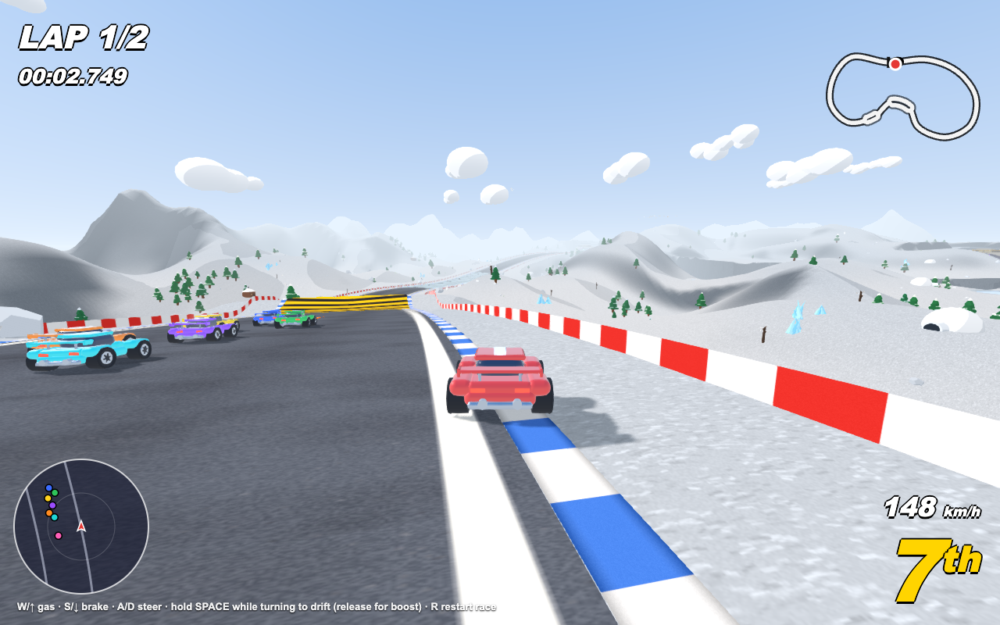

# Kart Racer

A low-fi, low-poly kart racer in the browser, built with three.js: eight cars, a four-track circuit, jumps, drifts and boost pads.

**Play it:** https://kart.akwiat.com



## What it is

You race seven CPU rivals over a circuit of four tracks, played in a random order, two laps each. Finishing positions earn Mario Kart-style points (15, 12, 10, 8, 6, 4, 2, 1), and a results screen after each race shows that race and the running circuit standings.

The tracks:

- **Alpine Valley**: route forks, shortcut lanes, a long mountain tunnel and a cinematic chasm jump
- **Jungle Ruins**: a twisty rainforest run past temple pyramids, through a lost temple and over river crossings
- **Neon City**: sunset streets between towers, long boulevards, sharp right-angle corners, an underpass and plenty of ramps
- **Frost Peaks**: flowing sweepers across snowfields, icy patches, moguls, a crevasse leap and an ice cave

Other bits:

- Drifting with a boost on release, dash pads, jumps, banked corners and jumpable walls and medians
- Tyre-grip handling and car-to-car bumps. Smash into a rival's side or land on it and it spins out
- Off-track respawn and a "WRONG WAY!" warning
- HUD with lap and time, speed, position, a track minimap and a radar of nearby cars
- Scenery: themed vegetation, mountains, lakes, grazing cows and sheep, and birds
- Bloom, FXAA and soft shadows, with resolution that scales down automatically if the frame rate drops

## Controls

| Key | Action |
|---|---|
| W / ↑ | Accelerate |
| S / ↓ | Brake / reverse |
| A / D or ← / → | Steer |
| Space or Shift (hold while turning) | Drift; release for a boost |
| R | Restart the race |
| Enter | Next race, from the results screen |

## Running locally

Requires [Bun](https://bun.sh).

```sh
bun install
bun run dev       # Vite dev server, then open the printed URL
bun run build     # production build into dist/
bun run preview   # serve the production build
```

In dev mode, `window.__kart` exposes some debugging helpers (`tour()`, `groundCheck()`, `closeup()`, `film()`).

## Tech stack

- [three.js](https://threejs.org/) for rendering, with post-processing (UnrealBloom, FXAA). All geometry and textures are generated in code, so there are no asset files.
- [Vite](https://vite.dev/) for dev and build
- Plain JavaScript ES modules, no framework
- Deployed as a static site (`deploy.sh`)
